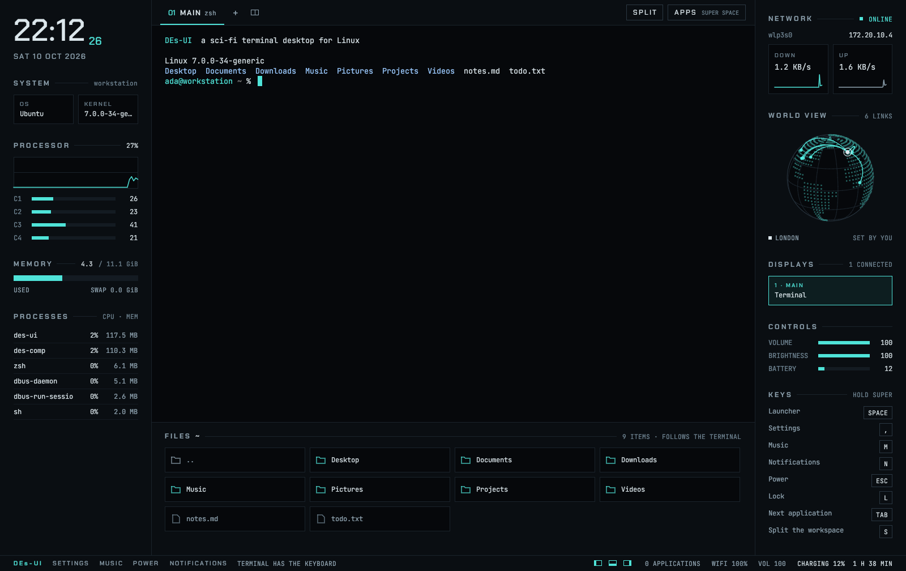
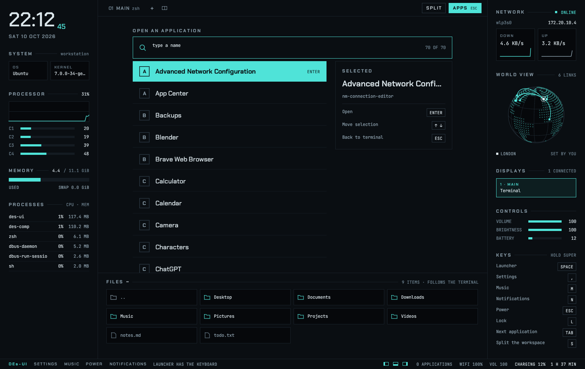
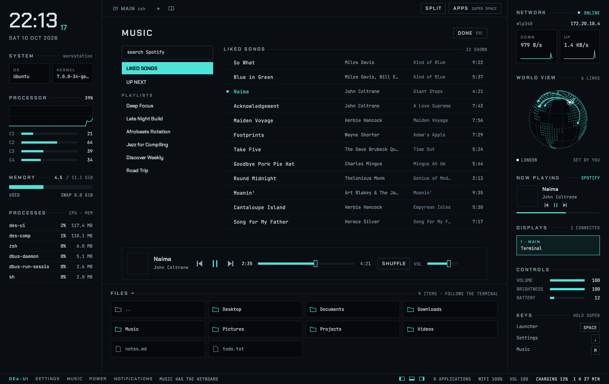
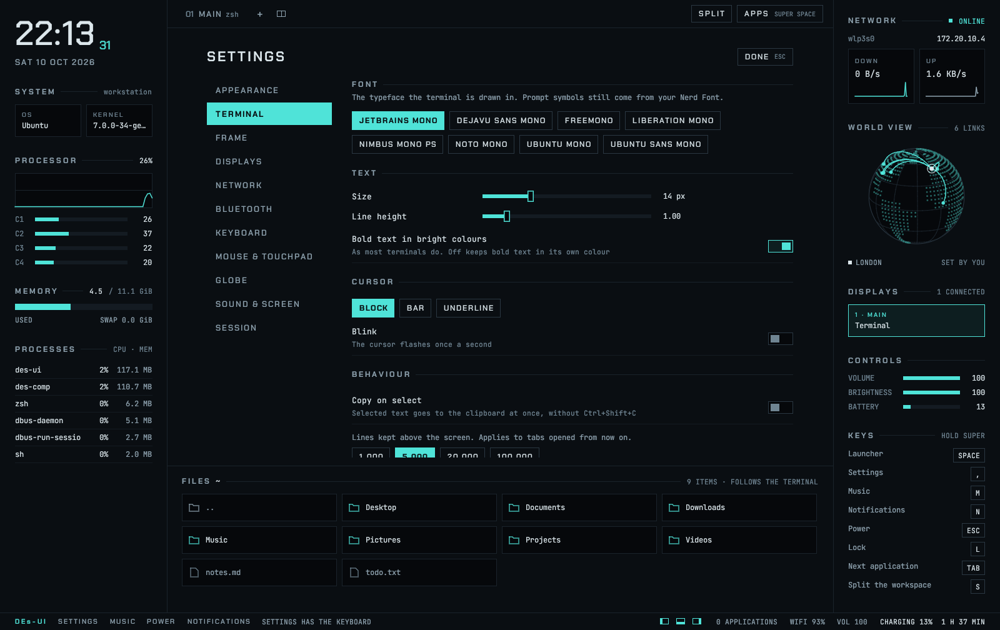

<div align="center">

<a href="https://coxy-trophy.github.io/des-website/"></a>

# DEs-UI

**A sci-fi terminal desktop for Linux, written in Rust.**

A Wayland compositor and a shell that run as their own login session:
the terminal in the middle, the machine drawn around it, applications inside the frame.

**[Website](https://coxy-trophy.github.io/des-website/)** · [Try it](#try-it-in-a-window) · [Install](#install-as-a-login-session) · [Keys](#keys) · [What is in it](#what-is-in-it) · [Not done yet](#not-done-yet)

</div>

> [!NOTE]
> DEs-UI is in development and is being built in the open. It is used daily on one
> machine; expect rough edges on yours. [What is missing](#not-done-yet) is listed
> plainly, and [docs/UNTESTED.md](docs/UNTESTED.md) lists what is built but not yet
> tried on real hardware.

The website has a version of the desktop you can use in the browser:
**[coxy-trophy.github.io/des-website](https://coxy-trophy.github.io/des-website/)**

## What it looks like

| | |
|:---:|:---:|
| <br>**An application** in the workspace, with notifications | <br>**The launcher** — <kbd>Super</kbd>+<kbd>Space</kbd> |
| <br>**The music player** — <kbd>Super</kbd>+<kbd>M</kbd> | <br>**The settings** — <kbd>Super</kbd>+<kbd>,</kbd> |
| <br>**The lock screen** — <kbd>Super</kbd>+<kbd>L</kbd> | <br>**The desktop** as it starts |

## What it is

One login session, made of three programs:

| Program | Where | What it does |
|---|---|---|
| **`des-ui`** | `shell/` | The interface: terminal, system panels, file browser, launcher, settings, lock and login screens. |
| **`des-comp`** | `compositor/` | A Wayland compositor that shows the shell fullscreen and places other applications in the middle of its frame. |
| **`des-music`** | `music/` | A Spotify player with no window of its own; the shell is its interface. |

```
┌─ des-comp ── drives the displays and input ───────────────┐
│ ┌─ des-ui ── drawn fullscreen ──────────────────────────┐ │
│ │ clock    │  terminal                      │ network   │ │
│ │ system   │  and your applications,        │ globe     │ │      ┌─ des-music ─┐
│ │ cpu, mem │  Wayland or X11                │ keys      │ │◄────►│ no window   │
│ │ procs    ├────────────────────────────────┤           │ │socket│ PipeWire    │
│ │          │  files (follow the terminal)   │           │ │      └─────────────┘
│ └───────────────────────────────────────────────────────┘ │
└───────────────────────────────────────────────────────────┘
```

## Inspired by eDEX-UI

DEs-UI began as a rewrite of **[eDEX-UI](https://github.com/GitSquared/edex-ui)** by
GitSquared, the sci-fi terminal that made this look famous. eDEX-UI was archived in
2021. DEs-UI takes the idea further in one direction: instead of an application that
covers your desktop, it *is* the desktop.

| | eDEX-UI | DEs-UI |
|---|---|---|
| What it is | A fullscreen terminal application | A desktop: its own login session |
| Runs | Inside your existing desktop | In place of it, with its own Wayland compositor |
| Built with | Electron (JavaScript) | Rust |
| Platforms | Windows, macOS, Linux | Linux |
| Other applications | Stay outside, behind it | Open inside the frame, split or full screen |
| Settings, lock and login screens | No; those belong to the desktop under it | Yes |
| Themes | Its own JSON format | The same format; eDEX-UI theme files work |
| On-screen keyboard, sound effects | Yes | [Not yet](#not-done-yet) |
| Licence | GPL-3.0 | MIT |
| Status | Archived, no longer maintained | In development |

No code is shared between the two. Only the theme format is, so that themes made for
eDEX-UI can be used here.

## Try it in a window

Nothing is installed and nothing on your machine changes:

```sh
sudo apt install libudev-dev libinput-dev libgbm-dev libseat-dev cage
git clone https://github.com/coxy-trophy/des-ui
cd des-ui
cargo build

./target/debug/des-comp                      # the whole desktop
./target/debug/des-comp -- --theme blade     # arguments after -- go to the shell
./target/debug/des-ui --windowed             # the shell on its own
```

Open applications with the launcher, or by starting them from the terminal.
`des-ui --list-apps` prints what the launcher offers.

## Install as a login session

    sudo apt install libudev-dev libinput-dev libgbm-dev libseat-dev cage
    ./install.sh

Then log out and choose **DEs-UI** from the session menu on the login screen.
Exiting the last shell, or Ctrl+Shift+Q, ends the session. `./uninstall.sh`
removes it again.

In the session, `des-comp` drives the displays and input devices itself (one GPU,
every monitor connected to it, including ones plugged in later). If that fails in the first seconds it falls back to running inside
`cage`, and the reason is in `~/.local/state/des-ui/session.log`. What applications started
from the launcher print goes to `apps.log` next to it.

Ways out if something goes wrong: **Ctrl+Alt+Backspace** ends the session, and
**Ctrl+Alt+F1…F12** switch virtual terminals.

## Keys

Hold <kbd>Super</kbd>, or <kbd>Ctrl</kbd>+<kbd>Alt</kbd>, which works when running in a
window.

| Key | What it does |
|---|---|
| <kbd>Space</kbd> | Open the launcher: type to search, Enter to open, Esc to cancel |
| <kbd>,</kbd> | Open the settings |
| <kbd>L</kbd> | Lock the screen |
| <kbd>Tab</kbd> | Switch between the terminal and the applications on this display |
| <kbd>S</kbd> | Split the workspace between two windows, or make it whole again |
| <kbd>←</kbd> <kbd>→</kbd> | Give the keyboard to that half of a split |
| <kbd>F</kbd> | Full screen: the applications on this display cover all of it |
| <kbd>[</kbd> <kbd>]</kbd> <kbd>\</kbd> | Collapse or open the left, right and bottom panels |
| <kbd>Q</kbd> | Close the current application |
| <kbd>O</kbd> | Move the current application to the next display |
| <kbd>M</kbd> | Open the music player |
| <kbd>N</kbd> | Open the notifications |
| <kbd>Esc</kbd> | Open the power menu |
| <kbd>Shift</kbd>+<kbd>R</kbd> | Restart the shell on a new build; applications stay open |

Without Super: <kbd>Print</kbd> takes a screenshot or starts a recording, and
<kbd>Ctrl</kbd>+<kbd>Alt</kbd>+<kbd>Backspace</kbd> ends the session.

The bar above the workspace lists the terminal tabs and every open application;
click one to switch to it. The application in use shows an arrow, to send it to
the next display, and a cross, to close it. `SPLIT`, `FULL` and `APPS` do what the
keys do, and the three small switches in the status strip collapse the panels.

A split keeps the window in view on the left and puts the application used before
it on the right. With one application open, that one goes right and the terminal
stays on the left.

With several displays, modes and arrangement follow what you chose in the settings,
or else the layout saved in GNOME's display settings (`~/.config/monitors.xml`)
when it covers the connected monitors.
Otherwise the frame is on a laptop's own panel and the others extend to its right.
Each further display shows its applications at full size, split or not.
Applications open on the display the pointer is on.

## The terminal

Ctrl+Shift+T opens a tab and Ctrl+Tab moves between them. The terminal can also be
split in two, each half showing a tab of its own:

- **Ctrl+Shift+E** — split side by side; again to make it whole
- **Ctrl+Shift+O** — split one above the other
- **Ctrl+Shift+arrow** — give the keyboard to the pane in that direction, as does a
  click in it
- **Ctrl+Tab** — change the tab in the pane in use

The small divided-frame button beside `+` does the same as Ctrl+Shift+E. Both tabs
stay open when the split ends. This is separate from Super+S, which shares the
workspace with an application.

## What is in it

Each of these opens for the details.

<details>
<summary><b>Settings</b> — theme, terminal, displays, network, Bluetooth, sound, and more</summary>

**Super+,** or `SETTINGS` in the status strip opens them in place of the terminal;
Esc closes. Changes apply at once and are saved.

- **Appearance** — theme
- **Terminal** — font, text size, line height, cursor shape and blink, bold in
  bright colours, copy on select, scrollback
- **Frame** — which panels are open, now and at every start
- **Displays** — each monitor's resolution and refresh rate, how large things are
  drawn on it (100% to 200%), which way it is turned, their order left to right,
  which one is the main display, and whether each other one is a desktop of its
  own, mirrors the main display, or is off
- **Network** — Wi-Fi on or off, and joining, leaving and forgetting networks;
  wired ports; and VPNs, brought in from a WireGuard `.conf` or OpenVPN `.ovpn`
  file, then connected, disconnected or forgotten
- **Bluetooth** — on or off, and pairing, connecting and forgetting devices,
  including those that show a code to type or to confirm
- **Keyboard** — layout, and how held keys repeat
- **Mouse & touchpad** — natural scrolling, tap to click, pointer speed, left-handed
- **Globe** — rotation, online lookups, and your location
- **Sound & screen** — volume and brightness; which device plays and which
  microphone listens, each with its level and a mute; and the volume of each
  application that is making sound
- **Session** — your picture for the lock and login screens, locking, where the
  logs are, and logging out

A display change is tried for 15 seconds and kept only if you confirm it; otherwise
it goes back by itself, so a mode your monitor cannot show does not strand you.
Confirmed layouts are saved in `~/.config/des-ui/displays`, one per set of
monitors, and come before GNOME's saved layout.

The rest are kept in `~/.config/des-ui/config` as `key = value` lines, which can also
be edited by hand. The compositor reads the keyboard, mouse and touchpad
settings from the same file. Network and Bluetooth go through `nmcli` and
`bluetoothctl`; a Wi-Fi password is handed to `nmcli` on its command line. Two can be set from a terminal:

    des-ui --set-location 48.8566,2.3522,Paris   # or: --set-location auto
    des-ui --geo off                             # no lookups at all; on to resume

X11 applications run through Xwayland, which `des-comp` starts and manages; the
clipboard is shared between them and Wayland applications.

The look is called Signal (`shell/src/ui.rs`): fixed greys, two typefaces, and one
accent colour. A theme sets that accent and the terminal's colours, in the JSON
format eDEX-UI uses, so its theme files work here. `themes/` holds the built-in
one; your own go in `~/.config/des-ui/themes/`.

</details>

<details>
<summary><b>Locking</b> — by key, by itself, and before sleep</summary>

**Super+L**, or `LOCK NOW` under Session in the settings, hides everything behind
your password; what was running keeps running. While locked the compositor shows
nothing but the lock screen and sends it every key, so no shortcut reaches what is
behind it. The password is checked with the system's own helper, `unix_chkpwd`.

It also locks by itself:

- after ten minutes without a key or the pointer being touched (Session in the
  settings changes how long, or turns it off), though not while an application is
  playing something to watch;
- before the machine sleeps, so that closing the lid and opening it again shows the
  lock screen (this too can be turned off there);
- when the system asks, as `loginctl lock-session` does.

If the lock screen ever cannot be unlocked, press Ctrl+Alt+F3, sign in on the text
console, and run `des-ui --unlock`.

</details>

<details>
<summary><b>Music</b> — a Spotify player in the workspace</summary>

**Super+M**, or `MUSIC` in the status strip, opens a Spotify player in the
workspace: search, your playlists, your saved albums and your liked songs, with the
track playing and its controls along the bottom. Long lists load the rest as you
scroll to their end. A track's artist and album can be clicked to go to them, search
finds albums and artists too, and `BACK` returns to the list you came from.

What plays on another of your devices shows here too, with `ON <DEVICE>` beside
it, and the controls then act on that device. `DEVICES` lists what is online; a
click moves the music there, or here. `REPEAT` goes from off to the whole list to
the one track, and `LIKE` puts the track among your liked songs (which asks once
more for Spotify's approval).

`LYRICS` shows the words of the track playing, from Spotify's own source. Where they
are timed to the music, the line being sung is picked out and kept in the middle,
and a click on any line goes to it. `UP NEXT` shows what is queued, and `+ QUEUE` on a
track under the pointer adds it. While something plays, the right column shows it
too, and the keyboard's play, next and previous keys work from anywhere.

It needs Spotify Premium, and two things done once, both from the music view:

1. **Sign in** (or `des-music login`), on Spotify's own page in your browser.
   This is what plays.
2. **Connect your library** (or `des-music library <client ID>`). Spotify turns
   away library requests made in a player's name, so reading playlists, liked songs
   and search needs an app of your own: at
   [developer.spotify.com/dashboard](https://developer.spotify.com/dashboard) create
   an app with the Redirect URI `http://127.0.0.1:8898/login` and the Web API ticked,
   and paste its Client ID into the music view.

`des-music logout` forgets both. Nothing else of Spotify needs to be installed or open.

The playing is done by `des-music`, built on
[librespot](https://github.com/librespot-org/librespot): it appears in Spotify's
device list as "DEs-UI", so a phone can control it as well, and it keeps playing
while the shell restarts. Sound goes out through PipeWire (`pw-cat`).

</details>

<details>
<summary><b>Power</b> — the power menu, the battery, and turning the screen off</summary>

**Super+Escape**, the power key, or `POWER` in the status strip opens the power
menu: lock, sleep, restart, shut down, log out. The last three take a second click.
While the screen is locked, the power key puts the machine to sleep.

The status strip shows the battery with the time left, or the time until it is
full. Running low, it says so at 15% and at 8%; at 4% the machine warns for a
minute and then goes to sleep, so that work is kept rather than lost to the
battery running out. Plugging in during that minute calls it off.

The screen can be turned off after a time left alone (Session in the settings;
off unless you choose a time). Any key or pointer movement turns it back on. Should
it ever stay dark, Ctrl+Alt+F3 and then Ctrl+Alt+F1 (or whichever console the
desktop is on) draws it afresh.

</details>

<details>
<summary><b>Screenshots and recordings</b> — full screen, an area, a window, or a recording</summary>

Press **Print** (PrtSc). The display stands still and asks what you want:

- **FULL SCREEN** (or F, or Enter): a picture of the display.
- **AREA** (or A): of a piece. Drag over the piece you want; dragging straight
  away, without choosing first, does the same.
- **WINDOW** (or W): of the window in use.
- **RECORD** (or R): start recording the display. `STOP` in the status strip, or
  Print and then **STOP RECORDING**, ends it. The strip shows how long it has
  been running.

Escape, Print again, or a click beside the choices calls it off. **Alt+Print**
and **Shift+Print** go straight to the window and to a piece.

Screenshots are saved in `~/Pictures/Screenshots` and, where `wl-copy` is
installed, also copied, ready to paste. Recordings are saved in
`~/Videos/Recordings` as MP4, with the pointer and without sound; they need
`ffmpeg`. Both programs come with `sudo apt install ffmpeg wl-clipboard`.

Nothing is pictured while the screen is locked.

</details>

<details>
<summary><b>Notifications</b> — toasts, the list, and do not disturb</summary>

The shell is the session's notification service, so what applications announce (a
message in the browser, a finished download) shows as a toast at the top right of
the workspace, above whatever is open, and is kept in a list. The desktop adds its
own: battery low, network lost and found, a display connected or removed.

A toast stays a few seconds, longer under the pointer; an urgent one stays until
seen to. Clicking it does what its sender offered (usually: show the application),
and the cross puts it away for good.

Each shows its sender's picture or icon where there is one, and makes a sound when
it shows, unless it asks for silence or for a sound of its own. Several at once make
one sound. **Settings → Sound & Screen → Notifications** turns the sounds off; do not
disturb silences all but the urgent. Icons that exist only as drawings (SVG) are not
shown.

**Super+N**, or `NOTIFICATIONS` in the status strip, opens the list. `DO NOT
DISTURB` there keeps all but the urgent ones off the screen; they still reach the
list. Nothing is shown over the lock screen. What is playing is the exception: the lock screen
shows the track, its cover and how far along it is, with previous, play or pause, and
next to click, and the keyboard's media keys work there too.

</details>

<details>
<summary><b>The globe</b> — where this machine is connected to, and what that tells whom</summary>

The globe marks this machine and the places it has connections open to. Positions
come from looking addresses up at get.geojs.io, which tells that service the public
addresses this machine talks to; each is asked about once and kept in
`~/.cache/des-ui/places.tsv`. Your own position is guessed from your address
unless you set it.

</details>

<details>
<summary><b>The splash</b> — while the shell restarts, and optionally while the machine boots</summary>

While the shell restarts (Super+Shift+R), the screen shows the desktop's name over a
bar that fills, in your theme's accent; the name glitches now and then. The
compositor draws it, in place of the blank the shell would leave.

The same screen can stand in for the maker's logo while the machine boots and
shuts down:

```sh
./install-boot-splash.sh      # uses sudo; rebuilds the boot image, which takes a minute
```

It is a Plymouth theme, made in the colours of the theme you use at the time; run it
again after changing theme. `./uninstall-boot-splash.sh` puts back what was there.

</details>

<details>
<summary><b>Its own login screen</b> — optional, in place of GDM</summary>

Optional, and separate from the above, because it changes how the machine boots:

    ./install-login.sh

That installs greetd, a small login manager, and makes the DEs-UI login screen the
machine's own in place of GDM, from the next boot. `./uninstall-login.sh` puts GDM
back. To see the screen without any of that: `des-ui --greeter --windowed`.

The screen shows a picture, a name and a password line. The picture is a pattern
made from the name unless you give it one, in **Settings → Session**
or with `des-ui --set-avatar <file>`. F1 changes
the session, Tab the account when there are several, and the three marks at the
bottom right suspend, restart and shut down, each on a second click.

The screen is shown by `des-comp` itself; its log is
`/var/lib/des-ui/greeter/login.log`. If it cannot start, a text login takes its
place. If the machine ever comes
up with no usable login at all, press Ctrl+Alt+F3, sign in on the text console, and
run `sudo systemctl disable greetd && sudo systemctl enable gdm3 && sudo reboot`.

</details>

## Working inside it while changing it

- `./dev.sh` builds the working copy and runs it in a window inside the running
  session. Nothing installed is touched.
- `./install.sh` can be run from inside the session. **Super+Shift+R** then restarts
  the shell on the new build: its terminal tabs close, applications stay open. A new
  compositor takes effect at the next login.
- If the shell crashes it is started again and applications stay open. Only quitting
  it (Ctrl+Shift+Q, or closing the last tab) ends the session.
- `install.sh` keeps the build it replaces. If a new build cannot start at login, the
  session tries that one, then `cage`.
- Anything that must survive a shell restart should not run in the shell's own
  terminal tabs: use a terminal application such as `ptyxis`, or `tmux`.

## Layout

<details>
<summary><b>Where things are in the source</b> — file by file</summary>

- `shell/src/term.rs` — shell on a PTY, VT parsing, grid rendering, key encoding
- `shell/src/sysmon.rs` — CPU, memory, process and network sampling
- `shell/src/ui.rs` — the interface language: colours, typefaces, shared parts
- `shell/src/panels.rs` — side columns, file browser, status strip
- `shell/src/globe.rs`, `geo.rs` — the rotating globe and the places on it
- `shell/src/settings.rs`, `config.rs` — the settings screen and the file behind it
- `shell/src/radio.rs` — Wi-Fi, wired and VPN connections, Bluetooth
- `shell/src/sound.rs` — output and input devices, levels, per-application volume
- `shell/src/greeter.rs`, `lock.rs` — the login screen and the lock screen
- `shell/src/power.rs` — locking before sleep, and what holds off the idle lock
- `common/src/input.rs` — keyboard, mouse and touchpad settings
- `shell/src/apps.rs`, `launcher.rs` — installed applications and the launcher
- `shell/src/theme.rs` — eDEX-UI theme loader
- `shell/src/music.rs` — the music view and what is playing
- `compositor/src/capture.rs`, `shell/src/capture.rs` — screenshots and recordings
- `compositor/src/splash.rs` — the splash shown while the session starts
- `shell/src/notify.rs`, `compositor/src/toast.rs` — notifications, and how their
  toasts get above the applications
- `music/src/main.rs`, `web.rs`, `protocol.rs` — the Spotify player, the library
  lookups, and the lines it exchanges with the shell
- `compositor/src/policy.rs` — which window is shown on which display
- `compositor/src/udev.rs`, `winit.rs` — the hardware and windowed backends
- `compositor/src/displays.rs`, `monitors.rs` — display settings and saved layouts
- `compositor/src/xwayland.rs`, `focus.rs` — X11 applications
- `compositor/src/lock.rs` — the session lock, and what it refuses to do
- `lock/src/main.rs` — the lock screen: Wayland by hand, no toolkit
- `lock/src/auth.rs` — PAM, on a thread of its own
- `compositor/src/ipc.rs`, `shell/src/desktop.rs` — the socket the two talk over
- `common/` — frame geometry and that socket's protocol, shared by both
- `session/` — login session entry and launcher

</details>

## Not done yet

- Keyboard layout setting
- Dialogs at their natural size; sharing the middle-click selection with X11 applications
- Placing displays above one another
- VPNs that ask for a password each time they connect
- In the music player: removing from or reordering the queue (Spotify offers outside
  apps no way to), an artist's most played tracks, the artists you follow, adding
  to and editing playlists, podcasts
- In notifications: icons that exist only as SVG drawings
- On the login screen: accounts that need more than a password
- From the original: on-screen keyboard, sound effects, mouse reporting to
  terminal apps

## Licence

MIT; see `LICENSE`, which is DEs-UI's and keeps Coxwell Wussah's copyright
notice, as the licence requires. `compositor/` is derived from Smithay's
`smallvil` example, also MIT. The bundled typefaces, Chakra Petch and JetBrains Mono (`shell/assets/fonts/`),
are under the SIL Open Font License.

eDEX-UI's own theme files are GPL-3.0 and are not part of this repository. They
work as themes here: copy them into `~/.config/des-ui/themes/`.
